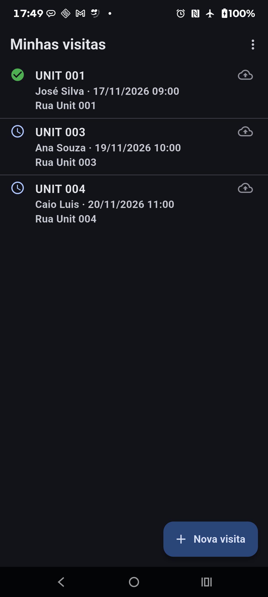
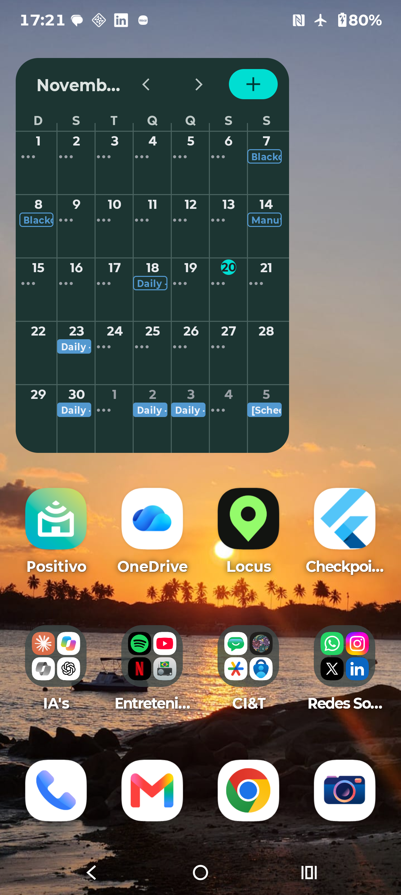

# Checkpoint Intensivo

Intensivão de Desenvolvimento Mobile — UNIT 2026, Prof. Petros Barreto.

**Aluno(a):** Sue Hellen Arruda da Silva

## Diário

| Encontro | O que entrou |
|---|---|
| 01 | login com Firebase Auth (emulador), AuthGate, SQLite por usuário, CRUD de visitas |
| 02 | Offline-first: VisitaFirestore, firestore.rules em uso, Sincronizador (puxar -> conflito LWW -> empurrar), lápide, barra de pendentes, logout com aviso, teste E2E |

## Como rodar

1. `firebase emulators:start --only auth,firestore --project demo-checkpoint`
2. `flutter run` (celular físico: `--dart-define=EMULATOR_HOST=<ip-do-pc>`)

## Intensivão 02 - Offline-first com sincronização

### Dívidas técnicas conscientes

| Dívida | Por que aceitamos agora | Como pagar depois |
|---|---|---|
| Conflito resolvido em silêncio (last-write-wins) | Simples e previsível para o MVP | Nível 3: mostrar as duas versões e deixar o usuário escolher |
| Depende do relógio do aparelho (`atualizadaEm`) | Não exige lógica no servidor | Número de versão incrementado a cada gravação |
| Lápides nunca são removidas do servidor | Garante que todo aparelho veja a exclusão | Função agendada que apaga lápides antigas |
| Banco local sem criptografia | Dados de teste, sem informação sensível | sqlcipher + flutter_secure_storage |
| Não sincroniza com o app fechado | Sincroniza ao abrir, ao salvar e no botão | workmanager (sincronização em segundo plano) |
